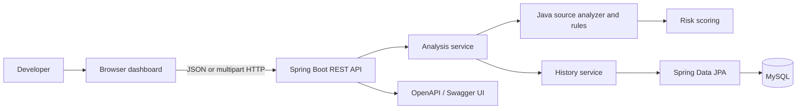

# CodeGuard AI

Rule-based Java source analysis for common security and code-quality issues, delivered through a REST API and web dashboard.

## What it is

CodeGuard AI is a small, self-hosted application that analyzes Java source text against a set of focused rules. Developers can paste code into the dashboard, submit it to the API, or upload a `.java` file to receive findings with source line numbers, severity, and rule-provided recommendations.

## The problem it solves

Finding common security mistakes, bugs, and code-quality issues during review can be repetitive and easy to overlook. CodeGuard AI provides a quick first-pass check for a small set of recognizable patterns, along with an overall score and a history of analysis summaries.

The analyzer is deterministic and rule-based: it is not an AI reviewer, Java compiler, or comprehensive static-analysis engine. Its text-pattern checks can miss issues or report patterns that need human context.

## Implemented features

- Analyze Java source sent as JSON or uploaded as a UTF-8 `.java` file.
- Detect hardcoded password-like assignments, hardcoded API keys/tokens/secrets, and `Runtime.getRuntime().exec(...)`.
- Detect empty `catch` blocks, TODO/FIXME comments, and `System.out.println(...)`.
- Return findings with rule ID, category, severity, line number, description, and remediation recommendation.
- Calculate a 0–100 score and map it to a risk level.
- Store and browse analysis summaries; source code and findings are not stored in history.
- Use the browser dashboard to edit source, load an example, review findings, and inspect history.
- Browse the API contract through OpenAPI and Swagger UI.

## Technology

- Java 17 and Spring Boot 4
- Spring MVC REST API
- Maven and Maven Wrapper
- Spring Data JPA / Hibernate
- MySQL for local or containerized application data; H2 for backend tests
- HTML, CSS, and JavaScript dashboard
- springdoc-openapi / Swagger UI
- Docker Compose and Nginx for the optional containerized development stack

There is no external AI or language-model integration in the current implementation.

## Architecture



The analyzer evaluates source text in memory. After successful analysis, only summary metrics and the timestamp are persisted for history; the submitted source and individual findings are not.

## Run locally

### Requirements

- Java 17
- MySQL
- Python 3, or another static-file server, to serve the dashboard

### 1. Clone the repository

```bash
git clone https://github.com/HimajaVentakaReddy/CodeGuard-AI.git
cd CodeGuard-AI
```

### 2. Create a MySQL database

Create a local database and application user:

```sql
CREATE DATABASE codeguard_ai;
CREATE USER 'codeguard_app'@'localhost' IDENTIFIED BY 'choose-a-local-password';
GRANT ALL PRIVILEGES ON codeguard_ai.* TO 'codeguard_app'@'localhost';
```

### 3. Configure the backend environment

`DB_USERNAME` and `DB_PASSWORD` are required. `DB_URL` defaults to the local URL below, and `DB_DDL_AUTO` defaults to `update` for development.

PowerShell:

```powershell
$env:DB_URL = "jdbc:mysql://localhost:3306/codeguard_ai?serverTimezone=UTC"
$env:DB_USERNAME = "codeguard_app"
$env:DB_PASSWORD = "your-local-password"
```

macOS/Linux:

```bash
export DB_URL="jdbc:mysql://localhost:3306/codeguard_ai?serverTimezone=UTC"
export DB_USERNAME="codeguard_app"
export DB_PASSWORD="your-local-password"
```

Do not commit real credentials. For production, provide secrets using the deployment platform and use an appropriately restricted database account and schema migration process.

### 4. Start the backend

From the repository root:

```powershell
cd backend
.\mvnw.cmd spring-boot:run
```

The API listens at `http://localhost:8080` by default.

### 5. Start the frontend

In a second terminal, from the repository root:

```powershell
cd frontend
python -m http.server 5500
```

Open `http://localhost:5500`. The dashboard is configured to call the backend at `http://localhost:8080`.

### Optional: Docker Compose

Docker Engine/Desktop with the Compose plugin is required. From the repository root, copy `.env.example` to `.env`, replace the placeholder values with local development credentials, then start the stack:

```powershell
Copy-Item .env.example .env
# Edit .env and replace the placeholder values.
docker compose up --build
```

Compose runs MySQL with a persistent `mysql_data` volume, the backend, and an Nginx frontend. The frontend is served on port 5500 and the backend on port 8080. Use `docker compose ps` to inspect service health and `docker compose down` to stop services while preserving database data. `docker compose down --volumes` also removes the database volume.

`.env` is ignored by Git. The checked-in `.env.example` contains placeholders for local development only, not production secrets.

## API

The API listens on port 8080 by default.

| Method | Endpoint | Description |
| --- | --- | --- |
| `GET` | `/api/health` | Service health status |
| `GET` | `/api/info` | Application name, version, and description |
| `POST` | `/api/analyze` | Analyze JSON Java source |
| `POST` | `/api/analyze/file` | Analyze a multipart `.java` file |
| `GET` | `/api/analyses` | List saved summaries, newest first |
| `GET` | `/api/analyses/{id}` | Retrieve one saved summary |

OpenAPI JSON is available at `http://localhost:8080/v3/api-docs`; Swagger UI is at `http://localhost:8080/swagger-ui/index.html`. Request and response formats and error cases are described in [docs/API.md](docs/API.md).

### Example request

```bash
curl -X POST http://localhost:8080/api/analyze \
  -H "Content-Type: application/json" \
  -d '{"code":"public class Example {\\n  private String password = \\"admin123\\";\\n}"}'
```

## Example analysis workflow

Submit Java source containing recognizable issues:

```java
public class ExampleService {
    private String password = "admin123";

    public void debug() {
        System.out.println("starting");
    }
}
```

The response includes a `SEC001` high-severity hardcoded-password finding and a `QUAL003` low-severity `System.out.println` finding, each with a line number and recommendation. It also includes the overall score and risk level. The successful analysis summary appears in history, but the source and findings are not retained there.

## Current project status

CodeGuard AI is an implemented, rule-based MVP with backend tests, a browser dashboard, analysis-summary persistence, documented REST endpoints, and Docker Compose configuration. Its rule coverage is intentionally limited to the patterns listed above; it does not compile source, perform comprehensive semantic analysis, provide authentication, or use AI-generated findings.

Run backend tests from the `backend` directory:

```powershell
.\mvnw.cmd test
```

The test suite uses an in-memory H2 database and does not require MySQL.
