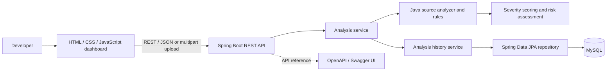

# CodeGuard AI

Rule-based Java source analysis for common security and code-quality issues, with a REST API and web dashboard.

## Overview

Developers need a fast way to identify common security vulnerabilities, bugs, code smells, and quality problems before code ships. CodeGuard AI accepts Java source through an editor, REST endpoint, or `.java` file upload, then reports matches from a focused set of source-level rules with severity, line number, and remediation guidance.

Analysis is deterministic and rule-based. It is not a Java compiler, static-analysis framework, or AI-powered reviewer; results are limited to the implemented rules and can require human review.

## Features

- Java source analysis through JSON requests and `.java` file uploads
- Detection of hardcoded passwords and API keys or tokens
- Detection of `Runtime.exec` use
- Detection of empty `catch` blocks, TODO/FIXME comments, and `System.out.println`
- Finding categories and severity classification
- Risk score from 0 to 100, with a corresponding risk level
- REST API with OpenAPI documentation and interactive Swagger UI
- Persistent summaries of successful analyses, without retaining source code or findings
- Browser dashboard with code editor, example source, result metrics, findings, and history
- Rule-provided recommendations for detected findings
- Docker Compose development stack for the API, MySQL, and frontend

## Architecture



The analyzer checks source text using the rules in the backend. Successful analyses store summary metrics in the database; source text and individual findings are not retained in history.

## Tech Stack

- **Java 17**
- **Spring Boot 4** — REST application and runtime
- **Maven** — build and dependency management; Maven Wrapper included
- **Spring MVC** — HTTP API
- **Spring Data JPA / Hibernate** — analysis-history persistence
- **MySQL 8.4** — local and production database option
- **H2** — in-memory database for tests
- **springdoc-openapi** — OpenAPI 3.1 document and Swagger UI
- **HTML, CSS, JavaScript** — dashboard
- **Docker, Docker Compose, Nginx** — optional local container stack

There is no external AI integration in the current implementation. The product name does not imply that findings are generated or explained by an AI model.

## Project Structure

```text
.
├── backend/
│   ├── Dockerfile
│   ├── pom.xml
│   ├── mvnw
│   └── src/
│       ├── main/
│       │   ├── java/com/codeguardai/
│       │   │   ├── analyzer/       # Analyzer interface and Java rule runner
│       │   │   ├── config/         # OpenAPI metadata
│       │   │   ├── controller/     # Health, info, analysis, and history endpoints
│       │   │   ├── entity/         # Persisted analysis summary
│       │   │   ├── model/          # Requests, responses, findings, enums
│       │   │   ├── repository/     # Spring Data repository
│       │   │   ├── rule/
│       │   │   │   ├── quality/    # Empty catch, TODO/FIXME, println rules
│       │   │   │   └── security/   # Password, token, Runtime.exec rules
│       │   │   └── service/        # Analysis, scoring, and history services
│       │   └── resources/application.properties
│       └── test/
│           ├── java/com/codeguardai/ # Analyzer, service, controller, app tests
│           └── resources/            # H2 config and representative Java samples
├── docs/
│   └── API.md
├── frontend/
│   ├── Dockerfile
│   ├── nginx.conf
│   ├── index.html
│   ├── css/style.css
│   └── js/app.js
├── docker-compose.yml
├── .env.example
└── README.md
```

## API Endpoints

The API listens on port `8080` by default. Interactive documentation is available at [`/swagger-ui/index.html`](http://localhost:8080/swagger-ui/index.html); the OpenAPI JSON is served at [`/v3/api-docs`](http://localhost:8080/v3/api-docs). Full request, response, and error details are in [docs/API.md](docs/API.md).

| Method | Endpoint | Purpose | Common errors |
| --- | --- | --- | --- |
| `GET` | `/api/health` | Service health | `500` unexpected server error |
| `GET` | `/api/info` | Public project metadata | `500` unexpected server error |
| `POST` | `/api/analyze` | Analyze JSON Java source | `400` invalid/blank code; `413` source too large; `500` processing or persistence failure |
| `POST` | `/api/analyze/file` | Analyze UTF-8 `.java` multipart upload | `400` invalid file; `413` upload too large; `500` read or persistence failure |
| `GET` | `/api/analyses` | List saved summaries, newest first | `500` history read failure |
| `GET` | `/api/analyses/{id}` | Fetch one saved summary | `400` invalid identifier; `404` not found; `500` history read failure |

Example JSON request:

```json
{
  "code": "public class Example {\n    private String password = \"admin123\";\n}"
}
```

The file endpoint expects a multipart part named `file`, a `.java` filename, valid UTF-8, and a file of at most 100,000 bytes. The multipart request limit is 120 KB. Successful analysis responses include the score, risk level, severity counts, and findings; a finding contains its rule ID, category, severity, source line, description, and recommendation.

## How to Run

### 1. Clone

```bash
git clone https://github.com/HimajaVentakaReddy/CodeGuard-AI.git
cd CodeGuard-AI
```

### 2. Database

Requirements for the normal local workflow: Java 17, MySQL, and Python 3 (or another static HTTP server).

Create a local MySQL database and application user:

```sql
CREATE DATABASE codeguard_ai;
CREATE USER 'codeguard_app'@'localhost' IDENTIFIED BY 'choose-a-local-password';
GRANT ALL PRIVILEGES ON codeguard_ai.* TO 'codeguard_app'@'localhost';
```

### 3. Environment variables

Set the database connection variables in the shell where the backend will run.

PowerShell:

```powershell
$env:DB_URL = "jdbc:mysql://localhost:3306/codeguard_ai?serverTimezone=UTC"
$env:DB_USERNAME = "codeguard_app"
$env:DB_PASSWORD = "your-local-password"
```

macOS/Linux:

```bash
export DB_URL="jdbc:mysql://localhost:3306/codeguard_ai?serverTimezone=UTC"
export DB_USERNAME="codeguard_app"
export DB_PASSWORD="your-local-password"
```

`DB_USERNAME` and `DB_PASSWORD` are required. `DB_URL` defaults to the local MySQL URL above; `DB_DDL_AUTO` defaults to `update` for local development. Use a migration strategy and least-privilege database account for production.

### 4. Backend

Start the backend:

```powershell
cd backend
.\mvnw.cmd spring-boot:run
```

### 5. Frontend

In a second terminal, start the frontend static server from the repository root:

```powershell
cd frontend
python -m http.server 5500
```

Open `http://localhost:5500`. The dashboard calls the API at `http://localhost:8080`.

### 6. Docker Compose (optional)

Requirements: Docker Engine/Desktop with the Compose plugin. From the repository root, copy `.env.example` to `.env` and replace its placeholder values with local-only credentials:

```powershell
Copy-Item .env.example .env
# Edit .env before starting the stack.
docker compose up --build
```

Compose builds the backend and Nginx frontend, starts MySQL, waits for its health check before starting the backend, and uses a persistent `mysql_data` volume. The frontend is at `http://localhost:5500`; the backend is at `http://localhost:8080`. Use `docker compose ps` to inspect service health and `docker compose down` to stop the stack while preserving database data. `docker compose down --volumes` also deletes the local database volume.

The checked-in `.env.example` contains placeholders, not production secrets. `.env` is ignored by Git. Never deploy these example credentials; inject production secrets through an appropriate secret manager.

## Example Analysis

Example source:

```java
public class ExampleService {
    private String password = "admin123";

    public void debug() {
        System.out.println("starting");
    }
}
```

The implemented rules report:

- `SEC001` — hardcoded password, `HIGH`, line 2. Recommendation: load the value from a secret store or environment variable.
- `QUAL003` — `System.out.println` use, `LOW`, line 5. Recommendation: use a logging framework.

These are text-pattern checks, not a full Java semantic analysis; review the source and findings in context.

## Screenshots

Screenshots can be added here as the dashboard evolves.

| Dashboard | Analysis findings | Analysis history |
| --- | --- | --- |
| _Add screenshot_ | _Add screenshot_ | _Add screenshot_ |

## Future Improvements

- Add parser-based analysis for more accurate Java syntax and context.
- Expand rule coverage and configurable rule sets.
- Add CI integration and machine-readable report export.
- Add optional, clearly labeled AI-assisted explanations with privacy controls.
- Add authentication and authorization if deployed for multiple users.

## Testing

Run the full backend suite, including analyzer rules, scoring, request validation, upload handling, controllers, OpenAPI endpoints, and H2-backed history persistence:

```powershell
cd backend
.\mvnw.cmd test
```

The tests use an in-memory H2 database and do not require a running MySQL server.

## Author

Himaja Venkata Reddy
