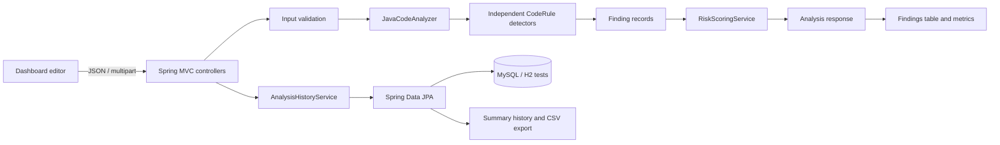

# CodeGuard AI architecture

CodeGuard AI is a deterministic, rule-based Java source analyzer with a Spring Boot REST API and a static browser dashboard. It does not use an external AI service, compile submitted Java, or perform full semantic or data-flow analysis.

## Component and request flow

### Backend responsibilities

| Area | Responsibility |
| --- | --- |
| `controller` | REST routes for health, project details, source analysis, and history; maps handled client errors to JSON. |
| `service` | Validates source limits, orchestrates analysis and scoring, and persists successful analysis summaries. |
| `analyzer` and `rule` | Splits source into lines, runs registered `CodeRule` implementations, and sorts findings by line and rule ID. |
| `model` | Immutable request, finding, score, response, and history-summary records and enums. |
| `entity` and `repository` | Store and retrieve only summary counts, score/risk level, and analysis timestamp. |

The request path accepts JSON source up to 100,000 characters or a UTF-8 `.java` upload up to 100,000 bytes (with a configured 120 KB multipart request limit). Successful responses include findings for that request. The history path does not retain the source or finding details.

## Detection and findings

Each detector is a Spring component implementing `CodeRule`; the analyzer runs each rule against the submitted lines and returns findings with a rule ID, title, description, category, severity, one-based line number, and recommendation. The current rules cover:

- `SEC001` and `SEC002`: non-empty string-literal assignments to password-like and API key/token/secret-like names.
- `SEC003`: `Runtime.getRuntime().exec(...)`.
- `SEC004`: direct `ProcessBuilder(...).start()` calls and simple declared `ProcessBuilder` variables followed by `.start()`.
- `QUAL001`–`QUAL003`: empty catch blocks, TODO/FIXME comments, and `System.out.println(...)`.

The rules use text patterns rather than a Java parser. They can miss equivalent or multiline syntax and can flag code that requires contextual review. A finding is a review signal, not proof of exploitability; absence of findings is not proof that source is safe.

## Score and risk-level semantics

The numeric score starts at 100 and deducts 25 points per CRITICAL, 15 per HIGH, 8 per MEDIUM, and 3 per LOW finding, clamped to 0–100. INFO findings do not deduct points. Score bands are CRITICAL (0–20), HIGH (21–40), MEDIUM (41–60), LOW (61–80), and GOOD (81–100).

The returned `riskLevel` is the more severe of the score-band risk and the highest individual finding severity. This preserves the numeric score formula while preventing a high-severity finding from being presented as GOOD. INFO findings do not raise the severity floor.

The dashboard's `Source lines` value counts physical source lines, excluding a trailing line terminator. `Issues / 100 lines` is `finding count × 100 ÷ source lines`, rounded to one decimal place. It is descriptive only: it does not normalize by language constructs or indicate detector coverage.

## Dashboard and history

The static dashboard sends source to the API, shows score/severity counts and findings, and filters the current findings client-side by severity and category. Titles, descriptions, and recommendations are displayed from the API response.

History endpoints return summaries only. The browser's CSV download exports summary columns (ID, timestamp, score, risk level, total issues, and severity counts); it does not include source or finding text. Analysis summaries are sorted newest first.

## Local development and verification

- Backend tests: `.\backend\mvnw.cmd -f .\backend\pom.xml test` from the repository root. Tests use H2 and do not require MySQL.
- Local dashboard: serve `frontend/` on port 5500 (for example, `python -m http.server 5500` from that directory).
- Backend: run `.\mvnw.cmd spring-boot:run` from `backend/` after configuring the database environment variables documented in the [README](../README.md).
- Docker Compose runs MySQL, backend, and Nginx-served frontend; GitHub Pages deployment publishes the static frontend only.

The frontend currently has no package-manager build or test script; verify its analysis, filters, history, and CSV download in a browser against a running backend.
